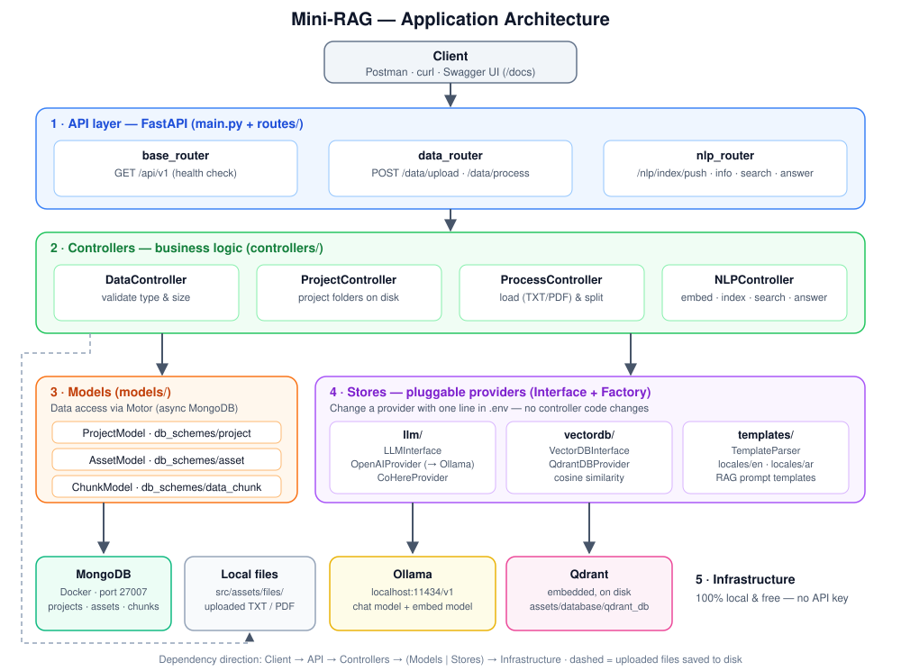
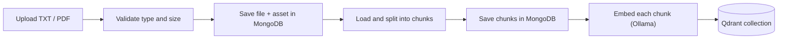
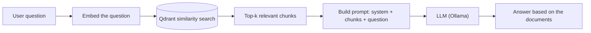

# Mini-RAG


-000000)


A minimal, **production-style** implementation of a **Retrieval-Augmented Generation (RAG)** backend.
Upload your documents (TXT / PDF), index them, then ask questions: the API retrieves the most relevant
passages and asks an LLM to answer **using only your documents**.

The whole stack runs **locally and for free** with [Ollama](https://ollama.com) — no OpenAI key required —
and the LLM / vector DB providers are pluggable.

---

## Table of contents

- [Features](#features)
- [Architecture](#architecture)
- [Why this architecture matters](#why-this-architecture-matters)
- [How the RAG pipeline works](#how-the-rag-pipeline-works)
- [Project structure](#project-structure)
- [Getting started](#getting-started)
- [Configuration](#configuration)
- [API reference](#api-reference)
- [Switching LLM providers](#switching-llm-providers)
- [Troubleshooting](#troubleshooting)
- [Roadmap](#roadmap)
- [License](#license)

---

## Features

- Upload **TXT** and **PDF** files with type and size validation
- Text extraction (LangChain loaders + PyMuPDF) and configurable **chunking** with overlap
- **Embeddings** generation and storage in a **Qdrant** vector database (cosine similarity)
- **Semantic search** over the indexed chunks
- **RAG answers**: retrieved chunks are injected into a prompt template and sent to the LLM
- Metadata (projects, assets, chunks) stored in **MongoDB** through the async driver **Motor**
- **Pluggable providers** (Interface + Factory): Ollama / OpenAI-compatible, Cohere, Qdrant
- **Multilingual prompt templates** (`en`, `ar`)
- **Free & private**: runs fully on your machine with Ollama

---

## Architecture



The application is split into **five layers**. A request always flows top to bottom, and each layer only
talks to the layer directly below it.

| # | Layer | Folder | Responsibility |
|---|-------|--------|----------------|
| 1 | **API** | `main.py`, `routes/` | Receives HTTP requests, validates payloads (Pydantic schemes), returns JSON. No business logic. |
| 2 | **Controllers** | `controllers/` | Business logic: file validation, document loading and chunking, embedding, indexing, search, RAG answer. |
| 3 | **Models** | `models/` | Data access to MongoDB (`projects`, `assets`, `chunks`) and their schemas. |
| 4 | **Stores** | `stores/` | Adapters to external technologies: `llm/`, `vectordb/`, `templates/`. Each one is defined by an **interface** and created by a **factory**. |
| 5 | **Infrastructure** | Docker / local | MongoDB (Docker), Qdrant (embedded, on disk), Ollama (local LLM server), uploaded files. |

---

## Why this architecture matters

| Design choice | Why it is important |
|---------------|---------------------|
| **Layered / MVC-like structure** (routes → controllers → models) | *Separation of concerns*: routes stay thin, logic is reusable and testable, and a change in one layer does not break the others. |
| **Interface + Factory pattern** for LLM and vector DB (`LLMInterface`, `VectorDBInterface`, `*ProviderFactory`) | The provider is chosen with **one line in `.env`**. Moving from paid OpenAI to free Ollama — or from Qdrant to another vector DB — requires no change in the controllers. This avoids vendor lock-in. |
| **Configuration through `.env`** (`helpers/config.py`, Pydantic Settings) | No secrets or model names in the code, easy to switch between dev / prod, safe to publish on GitHub. |
| **Async I/O** (FastAPI + Motor + aiofiles) | The API stays responsive while uploading files and querying the database. |
| **Separate metadata store and vector store** (MongoDB + Qdrant) | Each database does what it is best at: MongoDB for documents and relations, Qdrant for fast similarity search. |
| **Prompt templates outside the code** (`stores/templates/locales/`) | Prompts can be edited or translated without touching Python logic, which makes multilingual support simple. |
| **Local-first with Ollama** | Zero cost, no API key, and documents never leave your machine (privacy). |

---

## How the RAG pipeline works

**1. Indexing (done once per document)**



**2. Question answering (done at each question)**



---

## Project structure

```text
mini-rag/
├── docker/
│   ├── docker-compose.yml        # MongoDB service
│   └── .env.example              # MongoDB credentials
├── docs/
│   └── architecture.svg          # architecture diagram
├── src/
│   ├── main.py                   # FastAPI app, startup / shutdown, dependency wiring
│   ├── .env.example              # application settings
│   ├── requirements.txt
│   ├── helpers/config.py         # Pydantic settings
│   ├── routes/                   # base.py, data.py, nlp.py + schemes/
│   ├── controllers/              # Data, Project, Process, NLP controllers
│   ├── models/                   # MongoDB models, db_schemes/, enums/
│   ├── stores/
│   │   ├── llm/                  # LLMInterface, factory, OpenAI(Ollama) & Cohere providers
│   │   ├── vectordb/             # VectorDBInterface, factory, Qdrant provider
│   │   └── templates/            # prompt templates (en, ar) + parser
│   └── assets/                   # uploaded files + local Qdrant data (git-ignored)
├── LICENSE
└── README.md
```

---

## Getting started

### Prerequisites

- Python **3.11+** (Miniconda recommended)
- [Docker](https://docs.docker.com/get-docker/) (for MongoDB)
- [Ollama](https://ollama.com/download) (free local LLM runtime)
- Git

### 1. Clone the repository

```bash
git clone https://github.com/asmaedaouad/mini-rag.git
cd mini-rag
```

### 2. Install Ollama and download the models (free)

```bash
ollama pull llama3.2             # generation model
ollama pull nomic-embed-text     # embedding model (768 dimensions)
```

Ollama runs a local server on `http://localhost:11434`.

### 3. Start MongoDB

```bash
cd docker
cp .env.example .env             # then set MONGO_INITDB_ROOT_USERNAME / MONGO_INITDB_ROOT_PASSWORD
docker compose up -d
cd ..
```

### 4. Create the Python environment

```bash
conda create -n mini-rag-app python=3.11 -y
conda activate mini-rag-app
pip install -r src/requirements.txt
```

### 5. Configure the application

```bash
cd src
cp .env.example .env
```

Edit `.env` and set **your MongoDB credentials** in `MONGODB_URL`.
The default values already point to Ollama (see [Configuration](#configuration)).

### 6. Run the API

```bash
uvicorn main:app --reload --port 8000
```

Open the interactive documentation: **http://localhost:8000/docs**

---

## Configuration

All settings live in `src/.env`.

| Variable | Default (Ollama) | Description |
|----------|------------------|-------------|
| `GENERATION_BACKEND` | `OPENAI` | Provider used to generate answers (`OPENAI` = any OpenAI-compatible API, `COHERE`). |
| `EMBEDDING_BACKEND` | `OPENAI` | Provider used to create embeddings. |
| `OPENAI_API_URL` | `http://localhost:11434/v1` | Base URL of the OpenAI-compatible server (Ollama). |
| `OPENAI_API_KEY` | `ollama` | Any non-empty value with Ollama (ignored). |
| `GENERATION_MODEL_ID` | `llama3.2` | Chat model name. |
| `EMBEDDING_MODEL_ID` | `nomic-embed-text` | Embedding model name. |
| `EMBEDDING_MODEL_SIZE` | `768` | Vector size. **Must match the embedding model.** |
| `INPUT_DAFAULT_MAX_CHARACTERS` | `4000` | Max characters of a prompt sent to the LLM. |
| `GENERATION_DAFAULT_MAX_TOKENS` | `512` | Max tokens of the generated answer. |
| `GENERATION_DAFAULT_TEMPERATURE` | `0.1` | Low value = more factual answers. |
| `VECTOR_DB_BACKEND` | `QDRANT` | Vector database. |
| `VECTOR_DB_DISTANCE_METHOD` | `cosine` | Similarity metric (`cosine` or `dot`). |
| `MONGODB_URL` | – | MongoDB connection string. |
| `FILE_ALLOWED_TYPES` / `FILE_MAX_SIZE` | `text/plain`, `application/pdf` / `10` | Upload restrictions (size in MB). |
| `PRIMARY_LANG` / `DEFAULT_LANG` | `en` | Language of the prompt templates. |

> The `DAFAULT` spelling is kept as-is in the variable names because it matches `helpers/config.py`.

---

## API reference

Base URL: `http://localhost:8000/api/v1`

| Method | Endpoint | Description |
|--------|----------|-------------|
| `GET` | `/` | Health check (app name and version). |
| `POST` | `/data/upload/{project_id}` | Upload a TXT or PDF file. |
| `POST` | `/data/process/{project_id}` | Split the project's files into chunks. |
| `POST` | `/nlp/index/push/{project_id}` | Embed the chunks and store them in Qdrant. |
| `GET` | `/nlp/index/info/{project_id}` | Information about the project's vector collection. |
| `POST` | `/nlp/index/search/{project_id}` | Semantic search (returns the closest chunks). |
| `POST` | `/nlp/index/answer/{project_id}` | **RAG**: search + LLM answer. |

### Quick demo

```bash
# 1. Upload a document
curl -X POST "http://localhost:8000/api/v1/data/upload/1" -F "file=@mydoc.pdf"

# 2. Split it into chunks
curl -X POST "http://localhost:8000/api/v1/data/process/1" \
  -H "Content-Type: application/json" \
  -d '{"chunk_size": 500, "overlap_size": 50, "do_reset": 1}'

# 3. Index the chunks in the vector database
curl -X POST "http://localhost:8000/api/v1/nlp/index/push/1" \
  -H "Content-Type: application/json" \
  -d '{"do_reset": 1}'

# 4. Ask a question
curl -X POST "http://localhost:8000/api/v1/nlp/index/answer/1" \
  -H "Content-Type: application/json" \
  -d '{"text": "What is this document about?", "limit": 5}'
```

Example response of step 4:

```json
{
  "signal": "rag_answer_success",
  "answer": "…answer generated from your document…",
  "full_prompt": "…",
  "chat_history": [{"role": "system", "content": "…"}]
}
```

<!--
Add your screenshots here once the project runs, for example:


-->

---

## Switching LLM providers

Thanks to the provider abstraction, no code change is needed — only `.env`.

**Ollama (default, free)** — see `.env.example`.

**OpenAI (paid)**

```env
GENERATION_BACKEND="OPENAI"
EMBEDDING_BACKEND="OPENAI"
OPENAI_API_KEY="sk-..."
OPENAI_API_URL=
GENERATION_MODEL_ID="gpt-4o-mini"
EMBEDDING_MODEL_ID="text-embedding-3-small"
EMBEDDING_MODEL_SIZE=1536
```

**Cohere embeddings**

```env
EMBEDDING_BACKEND="COHERE"
COHERE_API_KEY="..."
EMBEDDING_MODEL_ID="embed-multilingual-light-v3.0"
EMBEDDING_MODEL_SIZE=384
```

> ⚠️ Each embedding model produces vectors of a different size. After changing the embedding model,
> update `EMBEDDING_MODEL_SIZE` and re-index with `"do_reset": 1` on `/nlp/index/push`,
> otherwise Qdrant will reject the vectors.

---

## Troubleshooting

| Problem | Solution |
|---------|----------|
| `Connection refused` on port 11434 | Ollama is not running: start it with `ollama serve` (or open the Ollama app). |
| `model "..." not found` | Download it first: `ollama pull <model>`. |
| Qdrant dimension error | `EMBEDDING_MODEL_SIZE` does not match the model. Fix it and re-index with `do_reset: 1`. |
| MongoDB authentication error | `MONGODB_URL` credentials must match `docker/.env`. |
| Slow answers | Use a smaller model (`llama3.2:1b`) or lower `limit` / `chunk_size`. |

---

## Roadmap

- [ ] Automated tests (pytest)
- [ ] Dockerfile for the API and a single `docker compose up` for the whole stack
- [ ] Streaming answers
- [ ] More document types (DOCX, Markdown)
- [ ] Simple web UI

---

## License

Distributed under the MIT License. See [`LICENSE`](LICENSE).

**Author:** Asmae Daouad — [GitHub](https://github.com/asmaedaouad)
